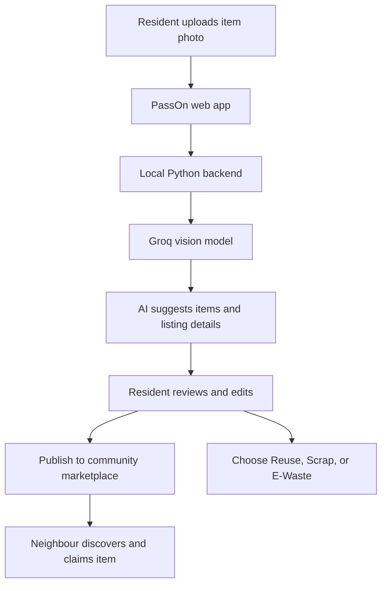

<div align="center">

# PassOn 🌱

### Turn the things your community no longer needs into things someone nearby can use.

A community reuse platform for hostels, PGs, campuses, flat-shares, and housing societies—with AI-assisted listings and clearer routes for items that cannot be reused.


[Getting started](#getting-started) · [How it works](#how-it-works) · [Honest by design](#honest-by-design)

</div>

---

## In plain English

When people move out, declutter, or replace everyday things, useful items can end up in the bin—not always because they're unusable, but because finding someone nearby who wants them takes effort. At the same time, a neighbour might be looking for that exact item.

**PassOn makes that handoff easier.** Take a photo of the things you're clearing out. AI suggests what they are and drafts listing details. Review the suggestions, choose whether each item should be reused, sent to scrap, or treated as e-waste, and publish to your local community.

Neighbours can browse and claim items, giving usable things a better chance of being used again.

**The intended impact:** less avoidable disposal, easier access to useful second-hand items, and a more practical way for local communities to act on waste. Actual environmental impact still needs to be measured in real-world use.

---

## Demo

PassOn has a responsive web experience with these main flows:

| Flow | What a resident does | What PassOn helps with |
|---|---|---|
| 📸 **Clear-out** | Upload a photo of items they no longer need | AI-generated item and listing suggestions |
| ✏️ **Review listings** | Check, edit, and choose a route for each item | Less effort creating listings one at a time |
| 🛍️ **Community marketplace** | Browse available items and claim something useful | Discovering items within a local community |
| 💚 **Community participation** | Save wanted items, view notifications, and explore Scrap Day | Keeping reuse and responsible disposal visible |
| 🌍 **Impact dashboard** | View community impact indicators | A snapshot of the project’s sustainability goal |

**Add product screenshots here before publishing:** the AI results page, marketplace, and impact dashboard would show the experience faster than a long description. Store real screenshots in `docs/screenshots/` and link them here once available; no screenshots are assumed to exist yet.

---

## What you can do

| Feature | You do this | You get this |
|---|---|---|
| **Community circles** | Join with a community invite code | A marketplace focused on your hostel, PG, campus, or society |
| **AI-assisted clear-out** | Upload a photo of one or more items | Suggested item names and listing details to review |
| **Reuse / Scrap / E-Waste** | Choose the appropriate route for an item | A clearer distinction between items people can reuse and items needing another route |
| **Marketplace and claiming** | Browse listings and claim an item | A way to pass useful things to neighbours |
| **Wishlist and notifications** | Save items you want | A place to track interest and community updates |
| **Scrap Day** | Explore community collection drives | A concept for grouping recyclable materials for collection |
| **Impact dashboard** | View the displayed impact indicators | Visibility into the project’s environmental goal |

---

## What this project demonstrates

| Area | What was built |
|---|---|
| **Computer vision / AI integration** | A photo-analysis flow that uses a vision model to suggest items and listing details |
| **Human-in-the-loop AI** | Users can review and edit suggestions before publishing instead of blindly accepting model output |
| **Product design** | A mobile-first experience with connected community, listing, marketplace, and item-detail flows |
| **Fallback behaviour** | Mock mode lets the interface be explored when live image analysis is unavailable |
| **API and cloud planning** | An OpenAPI contract and AWS SAM template provide a starting point for further backend deployment |

---

## How it works



The key design choice is that **AI reduces the work, but the person stays in control**. The suggestions are editable, and the user decides what to publish and which route to choose.

---

## Honest by design

PassOn aims to help reduce waste, but a dashboard or a successful demo is not proof of environmental outcomes. Here's what the current project does—and what it does not claim.

| Area | Current status |
|---|---|
| Responsive web experience | Implemented |
| Photo upload and AI listing suggestions | Implemented in the local Groq-powered flow |
| Mock fallback | Available for exploration without live AI |
| Marketplace, wishlist, claiming, and impact views | Present in the demo experience; parts use mock/demo data |
| API contract and AWS infrastructure definition | Present in the repository as a foundation for future integration |
| Fully deployed production cloud backend | **Not confirmed as deployed** |
| Verified recycling partners and collection operations | **Not established by the current demo** |
| Independently measured waste or CO₂ reduction | **Not available; displayed impact figures are illustrative estimates** |

This distinction matters: PassOn demonstrates a workflow intended to support reuse. To show real environmental benefit, the next step is to test it with residents and measure what actually gets reused or collected.

---

## How well does it work?

The latest project status reported:

- **38 backend tests passed** using `python backend/test_handlers.py`.
- **Frontend production build succeeded** using `npm run build`.

These are the latest reported results, not a guarantee about every checkout or environment. Re-run the commands below before a submission or demo.

---

## Where the live data comes from

- **AI item suggestions:** when configured, the local Python backend sends image-analysis requests to Groq using the `qwen/qwen3.8-27b` model.
- **Mock/demo content:** some community and marketplace experiences use demo data so the UI can be explored without a fully connected production backend.
- **Environmental indicators:** dashboard figures are illustrative estimates. They should not be presented as measured impact.
- **AWS:** the repository includes an AWS SAM template and OpenAPI contract. These files describe a foundation for deployment; they do not mean the cloud service is already live.

---

## Tech stack

| Part | Tool | Why |
|---|---|---|
| Frontend | React, Vite, Tailwind CSS | Responsive web interface |
| Backend | Python, Flask | Local API for image-analysis requests |
| Vision AI | Groq (`qwen/qwen3.8-27b`) | Generates item-identification and listing suggestions from images |
| API contract | OpenAPI | Documents API design and expected request/response shapes |
| Infrastructure definition | AWS SAM | Starting point for a serverless AWS deployment |
| Testing | Python test suite + frontend build | Checks backend behaviour and production frontend compilation |

---

## Getting started

### You need

- Node.js and npm
- Python
- A Groq API key if you want to use live image analysis

### 1. Start the frontend

From the repository root:

```bash
cd frontend
npm install
npm run dev
```

Open **http://localhost:5173**.

Demo details listed in the project:
- Email: `priya@example.com`
- Password: `password123`
- Community invite code: `SUN2026`

These are demo credentials, not production accounts.

### 2. Start the backend for live AI analysis

From the repository root, install the backend dependencies:

```bash
pip install -r backend/requirements.txt
```

Create `backend/.env` with your own Groq API key:

```env
GROQ_API_KEY=your_groq_api_key
GROQ_VISION_MODEL=qwen/qwen3.8-27b
BACKEND_PORT=3001
```

Then run:

```bash
python backend/server.py
```

Keep `.env` private and never commit your API key. If live AI is not configured or the backend is unavailable, mock mode can be used to explore the experience.

### 3. Run backend tests

From the repository root:

```bash
python backend/test_handlers.py
```

### 4. Build the frontend

```bash
cd frontend
npm run build
```

---

## Troubleshooting

| Problem | What to check |
|---|---|
| Frontend won't start | Confirm Node.js/npm are installed, run `npm install` in `frontend/`, then retry `npm run dev` |
| AI analysis uses mock results | Check that the backend is running and `GROQ_API_KEY` is set in `backend/.env` |
| Backend cannot find its API key | Check the `.env` file path and restart the backend after editing it |
| Groq reports a model error | Confirm the configured model is available to your Groq account and update `GROQ_VISION_MODEL` if needed |
| Frontend build fails | Run `npm install` in `frontend/` and inspect the first build error |
| Tests fail | Run the test command from the repository root and inspect the specific failing test |

---

## Project structure

```text
PassOn/
├── frontend/       # React web application and UI flows
├── backend/        # Python API, AI provider, and tests
├── contracts/      # OpenAPI specification
├── infra/          # AWS SAM template
└── seed/           # Demo data
```

---

## Challenges and what we learned

| Challenge | Design response |
|---|---|
| Listing several items can take time | Use photo-based AI suggestions to reduce repetitive data entry |
| AI can misidentify an item or suggest unsuitable details | Keep suggestions editable and require a person to review them |
| Not every item should be reused | Give users distinct Reuse, Scrap, and E-Waste route choices |
| A live AI service may be unavailable | Keep a mock fallback for exploring the UI and testing flows |
| A sustainability dashboard can imply more certainty than the data supports | Label impact figures as estimates until real outcomes are measured |

---

## Limitations and next steps

1. **Test with real residents.** Observe whether someone outside the team can upload, review, publish, and claim an item without help.
2. **Connect persistent production data and authentication.** Replace demo flows where needed and test the full journey end to end.
3. **Build trusted recycling handoffs.** Validate collection partners, e-waste handling, and what happens after an item is routed.
4. **Measure actual outcomes.** Track items reused or collected and document the method used for any environmental estimates.
5. **Deploy and monitor the cloud system.** Treat the current infrastructure template as a starting point, not a live deployment.

---

## Glossary

- **Reuse:** someone else uses an item again instead of it being discarded.
- **Scrap:** material routed for scrap collection or recycling, depending on local arrangements.
- **E-waste:** discarded electrical or electronic equipment that needs an appropriate collection and recycling route.
- **Vision AI:** AI that analyses images and can suggest what they contain.
- **Mock mode:** a demo/testing path that uses sample behaviour or data instead of a live service.

---

<div align="center">

**PassOn: make passing things on easier than throwing them away.**

*Built as a hackathon project. Live deployment, recycling partnerships, and real-world environmental outcomes should be verified separately.*

</div>
